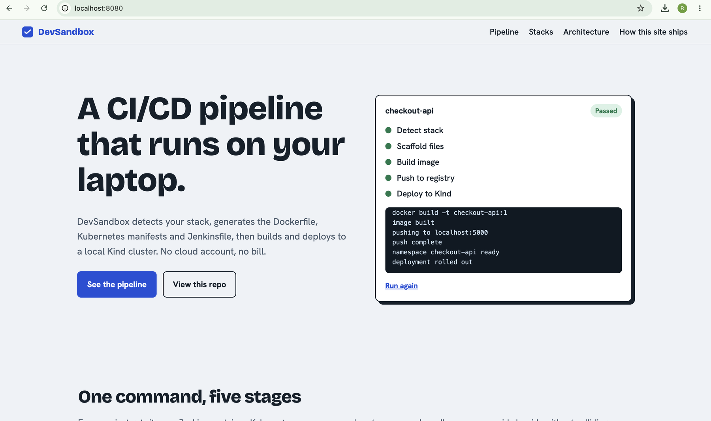
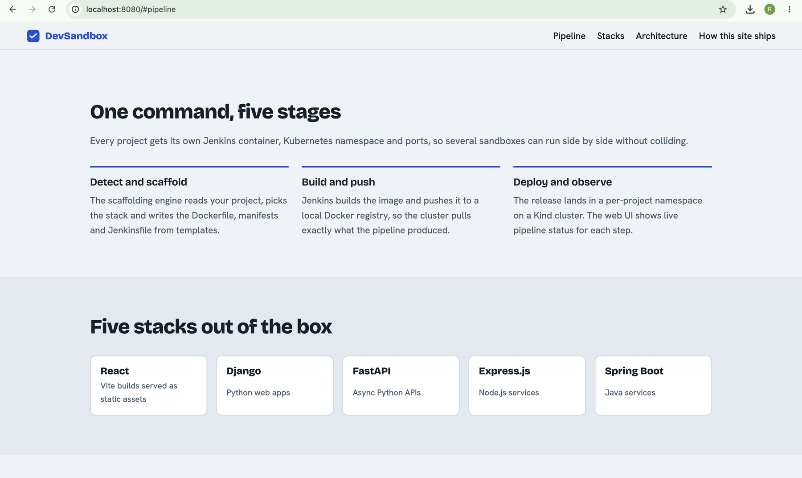
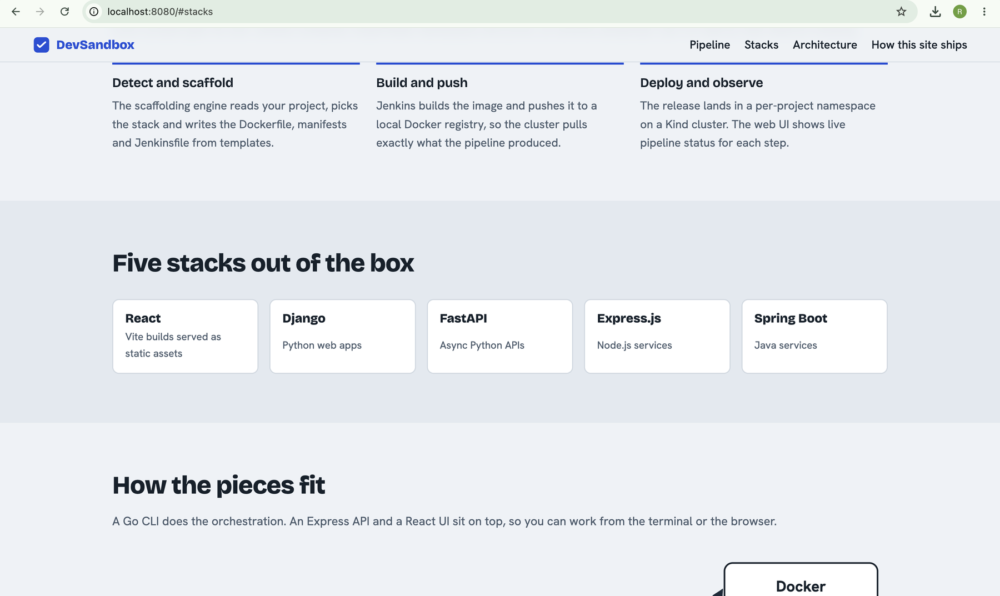
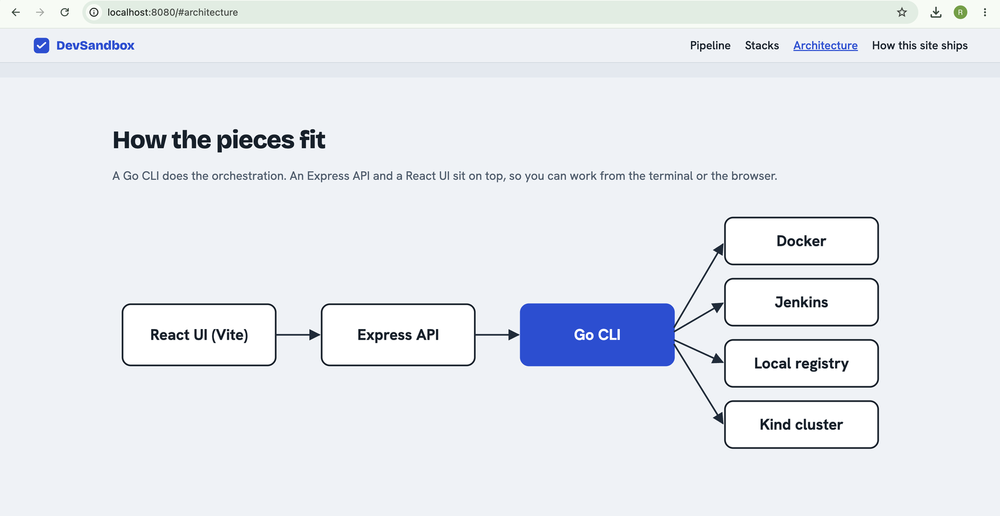
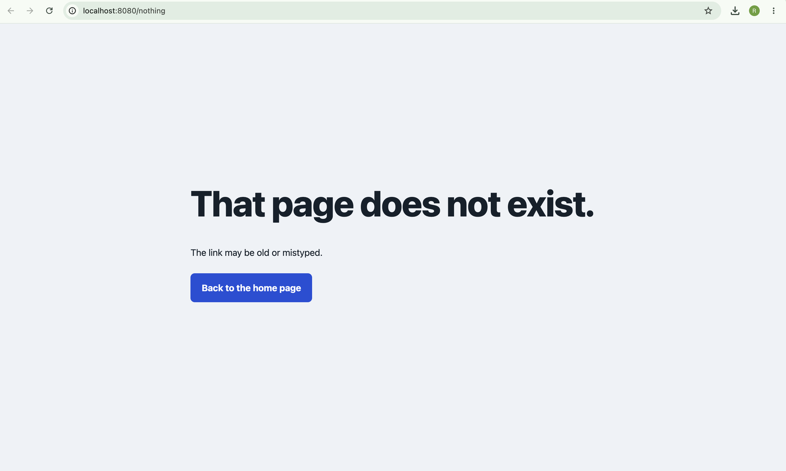
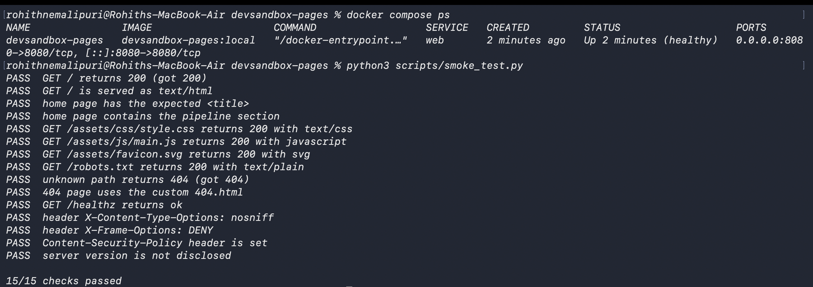

# DevSandbox Pages

[](https://github.com/ROHITH69/devsandbox-pages/actions/workflows/pages.yml)
[](LICENSE)

A static showcase site for **DevSandbox** (a local CI/CD platform), deployed to **GitHub Pages** through a tested GitHub Actions pipeline.

**Live site:** https://ROHITH69.github.io/devsandbox-pages/

> Task 6 of the Elevate Labs DevOps Internship: *Host a Static Website with GitHub Pages.*

## What this project does

| Task requirement | How it is met |
|------------------|---------------|
| Create an `index.html` file | `site/index.html` with CSS and a small JS demo |
| Push to a new GitHub repo | This repository |
| Enable GitHub Pages | Pages source set to **GitHub Actions** (see [deployment guide](docs/DEPLOYMENT.md)) |
| Access the live site | URL above, also printed by the `deploy` job |
| Customise with CSS | `site/assets/css/style.css` (responsive, accessible, reduced-motion aware) |

Beyond the minimum, the repo treats the site like a real service: every change is validated, built into a container, smoke-tested, and only then published.

## Pipeline

```
push / PR ─▶ validate ─▶ container-test ─▶ deploy (main only) ─▶ live smoke test
```

1. **validate**: `scripts/validate.py` checks HTML structure, local links, anchors and required files.
2. **container-test**: builds the nginx image, waits for its health check, runs `scripts/smoke_test.py`.
3. **deploy**: uploads `site/` as the Pages artifact and publishes it with the official actions.
4. **live smoke test**: the same HTTP checks run against the published URL.

See [docs/ARCHITECTURE.md](docs/ARCHITECTURE.md) for the diagram and design decisions.

## Run it locally

Requirements: Docker and Python 3.9+.

```bash
git clone https://github.com/ROHITH69/devsandbox-pages.git
cd devsandbox-pages

python scripts/validate.py                 # static checks
docker compose up -d --build               # http://localhost:8080
python scripts/smoke_test.py               # HTTP checks against the container
docker compose down
```

`make test`, `make up`, `make down` and `make screenshots` wrap the same commands on systems with `make`.

### Capture screenshots

Headless Chromium runs inside Docker, so nothing else is installed on your machine:

```bash
docker compose up -d --build
docker compose --profile tools run --rm screenshots
```

Images are written to [`screenshots/`](screenshots/).

## Screenshots

| Home page | Pipeline stages |
|-----------|-----------------|
|  |  |

| Supported stacks | Architecture |
|------------------|--------------|
|  |  |

| Custom 404 page | Smoke tests passing (15/15) |
|-----------------|-----------------------------|
|  |  |

## Repository layout

```
.
├── .github/
│   ├── workflows/pages.yml       CI/CD pipeline
│   ├── dependabot.yml            keeps actions and base image current
│   └── PULL_REQUEST_TEMPLATE.md
├── docker/                       nginx image (non-root, security headers, /healthz)
├── docs/                         architecture, deployment guide, interview Q&A
├── scripts/                      validate, smoke test, configure, screenshots
├── screenshots/                  proof of work
├── site/                         the website (this folder is what gets published)
├── docker-compose.yml
├── Makefile
└── LICENSE
```

## Documentation

- [Deployment guide](docs/DEPLOYMENT.md): setup, updating, rollback, custom domain, troubleshooting
- [Architecture](docs/ARCHITECTURE.md)
- [Interview questions and answers](docs/INTERVIEW_QUESTIONS.md): the seven questions from the task, answered

## About the site content

The hero animation is a simulated run written in plain JavaScript; it does not execute anything. The description of DevSandbox reflects the real project's design (Go CLI, Express API, React/Vite UI, Jenkins, Kind, local registry).

## License

[MIT](LICENSE)
