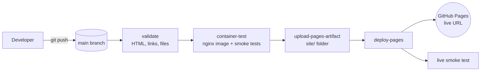

# Architecture

The site is plain static files. The engineering is in how it is validated, packaged and delivered.

## Components

| Path | Purpose |
|------|---------|
| `site/` | The website: `index.html`, CSS, JS, favicon, `404.html`, `.nojekyll` |
| `docker/` | Non-root nginx image that mirrors a production static host, with security headers and a health endpoint |
| `docker-compose.yml` | Local run (`web`) and an optional Playwright screenshot job (`screenshots`) |
| `scripts/validate.py` | Dependency-free static checks, run locally and in CI |
| `scripts/smoke_test.py` | HTTP checks against the container or the live URL |
| `scripts/configure.py` | Replaces the `ROHITH69` placeholder |
| `scripts/screenshots.py` | Headless Chromium captures into `screenshots/` |
| `.github/workflows/pages.yml` | Validate, container test, deploy, live smoke test |

## Design decisions

- **Actions-based deployment instead of "deploy from a branch".** The same workflow that tests the site publishes it, so a failing check blocks the release. GitHub's 10-builds-per-hour soft limit does not apply to custom Actions workflows.
- **`site/` is the deploy root.** Docs, scripts and CI config never reach the public site.
- **`.nojekyll` is included.** Pages serves the files as they are, without a Jekyll build.
- **The container is for parity and testing, not for production.** GitHub Pages serves the site; nginx lets you test headers, 404 handling and health checks locally.
- **Least privilege.** The workflow defaults to `contents: read`. Only the deploy job gets `pages: write` and `id-token: write`. The container runs as a non-root user with a read-only filesystem and all capabilities dropped.
- **No runtime dependencies.** Plain HTML, CSS and vanilla JS. Fonts load from Google Fonts with system-font fallbacks.
